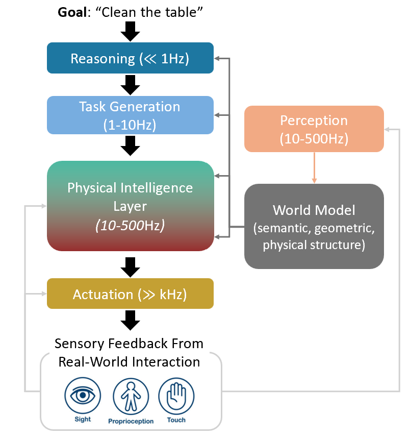
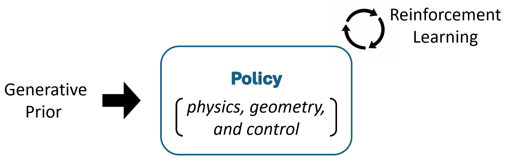
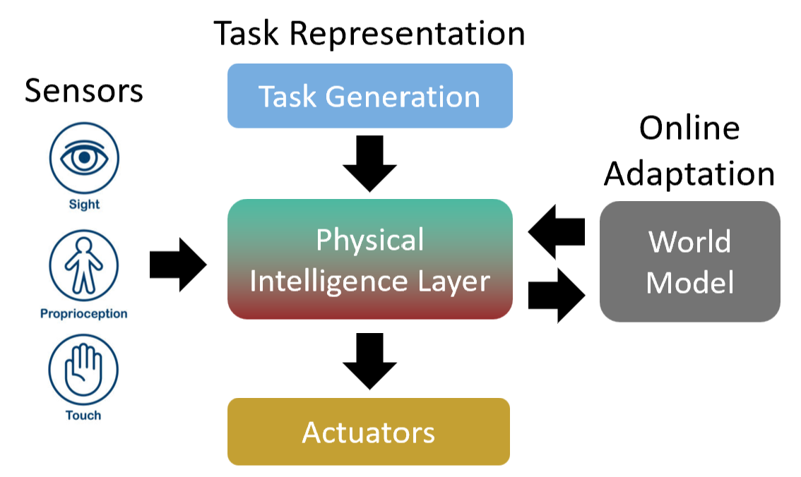

::: {.hero}

::: {.hero-intro}

::: {.hero-eyebrow}
Robotics and Physical AI Lab @ Yonsei
:::

```{=html}
<p class="hero-title">Ro<span class="hero-phi">Φ</span> Lab</p>
```

::: {.hero-pronunciation}
Also written **RoPhi** · pronounced *ROH-fai*
:::

:::

::: {.hero-lead}
**Ro$\Phi$ Lab** aims to develop *general robot intelligence*—robots that can perceive, plan, act, and adapt intelligently in the physical world. Our approach integrates learning with priors from physics, geometry, and control to achieve data-efficient, robust, and generalizable robotic behavior.
:::

::: {.hero-meta}
Principal Investigator: [Yonghyeon Lee](people.qmd#principal-investigator)
:::

::: {.hero-areas}
[Research areas:]{.hero-areas-label} *Robot learning, dexterous and contact-rich manipulation, reactive planning and control, real-time perception for control*
:::

:::

## Research Preview

```{=html}
<div class="preview-carousel" data-preview-source="publications.html">
  <button class="preview-nav preview-nav--prev" type="button" aria-label="Scroll to previous videos" hidden>&#8249;</button>
  <div class="preview-track" id="preview-track" tabindex="0" aria-label="Research video previews, latest to oldest">
    <p class="preview-empty">Loading research previews…</p>
  </div>
  <button class="preview-nav preview-nav--next" type="button" aria-label="Scroll to next videos" hidden>&#8250;</button>
</div>
<script>
(function () {
  // Builds the homepage preview strip from the Publications page.
  // Videos are pulled in document order, which the Publications page keeps
  // latest -> oldest, so adding a new publication updates this automatically.
  function initPreviewCarousel() {
    var carousel = document.querySelector(".preview-carousel");
    if (!carousel) return;
    var track = carousel.querySelector(".preview-track");
    var source = carousel.getAttribute("data-preview-source") || "publications.html";

    fetch(source)
      .then(function (res) {
        if (!res.ok) throw new Error("HTTP " + res.status);
        return res.text();
      })
      .then(function (html) {
        var doc = new DOMParser().parseFromString(html, "text/html");
        var items = Array.prototype.slice.call(doc.querySelectorAll(".pub-item"));
        track.innerHTML = "";

        var count = 0;
        items.forEach(function (item) {
          var video = item.querySelector("video");
          if (!video) return;
          var src = video.getAttribute("src");
          if (!src) return;

          var titleEl = item.querySelector(".pub-title");
          var venueEl = item.querySelector(".pub-venue");
          var title = titleEl ? titleEl.textContent.trim() : "";
          var venue = venueEl ? venueEl.textContent.trim() : "";

          var slide = document.createElement("a");
          slide.className = "preview-slide";
          slide.href = item.id ? source + "#" + item.id : source;

          var v = document.createElement("video");
          v.src = src;
          v.autoplay = true;
          v.loop = true;
          v.muted = true;
          v.playsInline = true;
          v.setAttribute("muted", "");
          v.setAttribute("playsinline", "");
          v.setAttribute("preload", "metadata");
          if (title) v.setAttribute("aria-label", title + " preview");

          var cap = document.createElement("div");
          cap.className = "preview-caption";
          var t = document.createElement("span");
          t.className = "preview-caption-title";
          t.textContent = title;
          cap.appendChild(t);
          if (venue) {
            var vn = document.createElement("span");
            vn.className = "preview-caption-venue";
            vn.textContent = venue;
            cap.appendChild(vn);
          }

          slide.appendChild(v);
          slide.appendChild(cap);
          track.appendChild(slide);
          count++;
        });

        if (!count) {
          track.innerHTML = '<p class="preview-empty">No previews available yet.</p>';
          return;
        }
        setupNav(carousel, track);
      })
      .catch(function (err) {
        track.innerHTML = '<p class="preview-empty">Could not load previews. See the <a href="' + source + '">Publications</a> page.</p>';
        console.error("Preview carousel failed:", err);
      });
  }

  function setupNav(carousel, track) {
    var prev = carousel.querySelector(".preview-nav--prev");
    var next = carousel.querySelector(".preview-nav--next");
    if (!prev || !next) return;

    function scrollByAmount(dir) {
      var amount = Math.max(track.clientWidth * 0.8, 240);
      track.scrollBy({ left: dir * amount, behavior: "smooth" });
    }

    function updateNav() {
      var maxScroll = track.scrollWidth - track.clientWidth - 1;
      var overflowing = track.scrollWidth > track.clientWidth + 2;
      prev.hidden = !overflowing;
      next.hidden = !overflowing;
      if (overflowing) {
        prev.disabled = track.scrollLeft <= 0;
        next.disabled = track.scrollLeft >= maxScroll;
      }
    }

    prev.addEventListener("click", function () { scrollByAmount(-1); });
    next.addEventListener("click", function () { scrollByAmount(1); });
    track.addEventListener("scroll", updateNav, { passive: true });
    window.addEventListener("resize", updateNav);
    updateNav();
  }

  if (document.readyState === "loading") {
    document.addEventListener("DOMContentLoaded", initPreviewCarousel);
  } else {
    initPreviewCarousel();
  }
})();
</script>
```

## Join Us

::: {.callout-important appearance="simple"}
## We are recruiting

**PhD and Master's positions are open.** If you are interested in joining the lab, please [reach out](mailto:). Admissions follow the [department's schedule](https://ai.yonsei.ac.kr/), but even if the timing does not line up, we strongly encourage you to start with an internship in the lab beforehand. See the [Join](join.qmd) page for details.
:::

## News

```{=html}
<div class="news-feed" data-news-source="publications.html" data-news-years="2">
  <ul class="news-list" id="news-list">
    <!-- MANUAL NEWS: edit these freely (newest first). Paper acceptances are
         added automatically below these items from the Publications page. -->
    <li class="news-item news-item--manual"><span class="news-date">Sep 2026</span> Ro&Phi; Lab officially launches at Yonsei University.</li>
    <!-- Auto-generated acceptance news is inserted after this placeholder. -->
    <li class="news-loading">Loading recent news…</li>
  </ul>
</div>
<script>
(function () {
  // Appends paper-acceptance news from the Publications page below the manual
  // items above. Publications are kept latest -> oldest there, so acceptances
  // shown here update automatically whenever a new publication is added.
  var SMALL_NUMBERS = ["", "One", "Two", "Three", "Four", "Five", "Six",
    "Seven", "Eight", "Nine", "Ten", "Eleven", "Twelve"];

  function numberWord(n) {
    return SMALL_NUMBERS[n] || String(n);
  }

  function parseVenue(text) {
    // Ignore entries that are not peer-reviewed acceptances.
    if (/preprint|arxiv|thesis/i.test(text)) return null;
    var yearMatch = text.match(/\b(20\d{2}|19\d{2})\b/);
    if (!yearMatch) return null;
    var year = parseInt(yearMatch[0], 10);
    // Prefer an abbreviation in parentheses, e.g. (ECCV), (RA-L), (T-RO).
    var abbrevMatch = text.match(/\(([A-Z][A-Za-z0-9\-\/\.]*)\)/);
    var name = abbrevMatch ? abbrevMatch[1] : text.split(",")[0].trim();
    return { name: name, year: year };
  }

  function clearLoading(list) {
    var loading = list.querySelector(".news-loading");
    if (loading) loading.remove();
  }

  function initNews() {
    var feed = document.querySelector(".news-feed");
    if (!feed) return;
    var list = feed.querySelector(".news-list");
    var source = feed.getAttribute("data-news-source") || "publications.html";
    var maxYears = parseInt(feed.getAttribute("data-news-years") || "2", 10);

    fetch(source)
      .then(function (res) {
        if (!res.ok) throw new Error("HTTP " + res.status);
        return res.text();
      })
      .then(function (html) {
        var doc = new DOMParser().parseFromString(html, "text/html");
        var items = Array.prototype.slice.call(doc.querySelectorAll(".pub-item"));

        var groups = [];
        var byKey = {};
        items.forEach(function (item) {
          var venueEl = item.querySelector(".pub-venue");
          var titleEl = item.querySelector(".pub-title");
          if (!venueEl) return;
          var venue = parseVenue(venueEl.textContent.trim());
          if (!venue) return;
          var key = venue.name + " " + venue.year;
          if (!byKey[key]) {
            byKey[key] = {
              name: venue.name,
              year: venue.year,
              count: 0,
              title: titleEl ? titleEl.textContent.trim() : "",
              id: item.id || ""
            };
            groups.push(byKey[key]);
          }
          byKey[key].count++;
        });

        // Keep only the most recent N distinct years (already newest-first).
        var years = [];
        groups.forEach(function (g) {
          if (years.indexOf(g.year) === -1) years.push(g.year);
        });
        var allowed = years.slice(0, maxYears);
        var shown = groups.filter(function (g) {
          return allowed.indexOf(g.year) !== -1;
        });

        // Keep the manual items above; only manage the auto-generated ones.
        clearLoading(list);
        shown.forEach(function (g) {
          var li = document.createElement("li");
          li.className = "news-item news-item--auto";
          var venueLabel = g.name + " " + g.year;
          if (g.count === 1) {
            var href = g.id ? source + "#" + g.id : source;
            li.innerHTML = 'One paper on \u201C<a href="' + href + '">' +
              escapeHtml(g.title) + "</a>\u201D is accepted at " +
              escapeHtml(venueLabel) + ".";
          } else {
            li.innerHTML = "<strong>" + numberWord(g.count) +
              " papers</strong> are accepted at " + escapeHtml(venueLabel) + ".";
          }
          list.appendChild(li);
        });
      })
      .catch(function (err) {
        clearLoading(list);
        console.error("News feed failed:", err);
      });
  }

  function escapeHtml(str) {
    return str.replace(/[&<>"']/g, function (c) {
      return { "&": "&amp;", "<": "&lt;", ">": "&gt;", '"': "&quot;", "'": "&#39;" }[c];
    });
  }

  if (document.readyState === "loading") {
    document.addEventListener("DOMContentLoaded", initNews);
  } else {
    initNews();
  }
})();
</script>
```


## Research

The idea that **intelligence must have a body**, articulated in Brooks's early 1990s work [@brooks1990elephants], challenged the traditional view of intelligence as disembodied reasoning and stressed its grounding in real-world interaction. @pfeifer2001understanding later formalized this perspective as **embodied intelligence**. Brooks's *subsumption architecture* [@brooks1986robust] showed that intelligent behavior can emerge from *layered, loosely coupled modules* running *asynchronously and in parallel*, with higher layers shaping—but not micromanaging—the reactive layers below. *We take this layered, modular structure as a blueprint for general embodied intelligence.*

@fig-modular-hierarchy illustrates an exemplar hierarchical, modular control architecture for robotic manipulation.
Because each layer operates at its own timescale, the stack stays robust: fast low-level controllers need not wait for slower modules, so delay or noise in one layer is less likely to destabilize the system, while higher layers can still subsume lower ones when needed. The modular design also improves explainability, debuggability, and scalability.

::: {.research-figures}
{#fig-modular-hierarchy fig-cap="*Subsumption*-style layers: perception, reasoning, planning, control, and actuation." fig-alt="Diagram of a modular hierarchical robot control architecture"}
:::

Our research agenda has two broad directions. The first is to develop 
**a physical intelligence layer**: a physical policy that enables reactive, robust, safe, 
and generalizable robot behavior. 
Pure trajectory-based imitation learning or reinforcement learning 
often struggles to generalize to unseen observations and tasks. 
We believe that leveraging appropriate priors from generative models, _physics, geometry, and control theory_ 
is key to building such a layer (@fig-policy-layer).

The second direction is to design **the interfaces that connect this physical intelligence 
layer to the broader robotic system**, including task representation, multimodal sensing, actuation, and the world models (@fig-interfaces). 
A central challenge is to find the right level of abstraction for task representation. 
The representation should not be overly constrained, 
so that the low-level controller retains sufficient freedom and redundancy, 
but it should also be informative enough to enable real-time action generation. 
Developing such balanced task representations is an important research direction. 

Another key question is how to properly integrate tactile and visual feedback. 
Rather than simply vectorizing all sensory inputs and ignoring their physical structure, 
we aim to exploit the geometric and physical structure of multimodal signals, such as contact locations, 
surface normals, force distributions, object geometry, and motion constraints. 

Finally, online adaptation is essential, since real-world robotic systems inevitably face unmodeled effects, 
changing environments, and partial observations. 
To address this, we aim to develop statistically efficient few-shot online 
adaptation algorithms that can rapidly update the robot’s behavior using limited real-world interaction.

::: {.research-figures .research-figures-duo}
{#fig-policy-layer fig-alt="Diagram of the physical intelligence policy layer"}

{#fig-interfaces fig-alt="Diagram of interfaces between control modules"}
:::

See the [Research](research.qmd) page for current projects and the [Publications](publications.qmd) page for our papers.


