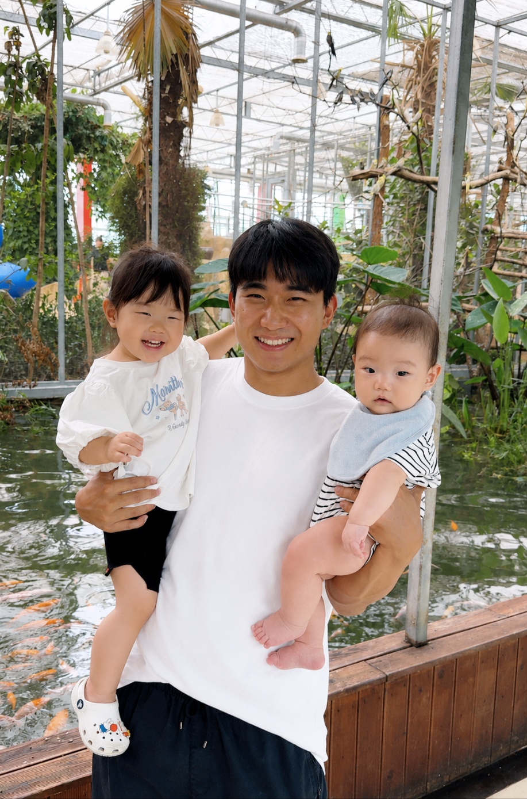

## Principal Investigator {#principal-investigator}

::: {.person-card}
::: {.person-layout}
::: {.person-photo}
{fig-alt="Portrait of Yonghyeon Lee"}
:::
::: {.person-bio}
### Yonghyeon Lee

*Principal Investigator*

- Assistant Professor, [Robotics and Physical AI Lab, Yonsei AI](index.qmd) (Sep 2026–)
- Postdoctoral Associate, [MIT Biomimetic Robotics Lab](https://biomimetics.mit.edu/) (2025–Aug 2026)
- AI Research Fellow, [KIAS AI Center](https://www.kias.re.kr/kias/cp/centrsPgmsMng/introduction.do?centrspgmsCd=AI&menuNo=403020) (2023–2025)
- Ph.D., [SNU Robotics Lab](https://sites.google.com/robotics.snu.ac.kr/fcp/home) (2018–2023)

- **Email:** [](mailto:)
- **Links:** [Google Scholar](https://scholar.google.com/citations?user=jizxpZYAAAAJ&hl=ko&oi=ao)
:::
:::
:::

## Ph.D. Students

*Positions opening soon. See [Join](join.qmd) for details and how to apply.*

## Master's & Undergraduate Researchers

*We will list current team members here as the group grows.*

## Alumni

*Former lab members will be listed here.*
